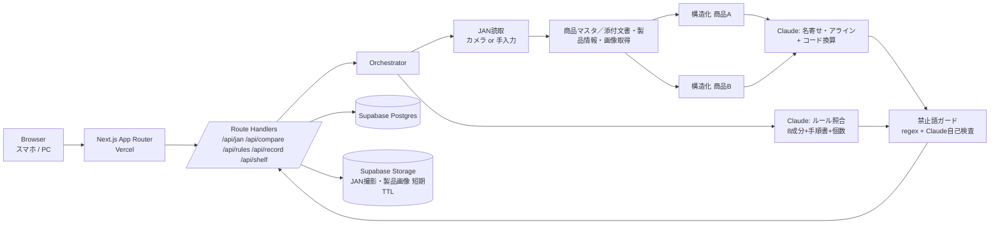

# System Architecture — ハコヨミ（HakoYomi）【仮名】

Version 1.1 / 2026-11-02 / 関連：`prd.md` `rules.md`（§5 JAN主経路に追随）

## 1. High-level Diagram

- 主経路は**JAN → 添付文書／製品情報**。箱面OCRは補助（マスタ欠落時のフォールバック）に留める。
- Supabase Auth は使わない（MVP）。DBアクセスはサーバー側の service role のみ。

## 2. Technology Stack
| 層 | 技術 | 理由 |
|---|---|---|
| Frontend | Next.js（App Router）+ TypeScript + Tailwind CSS | スマホ/PC両対応、Vercel直結 |
| UI部品 | shadcn/ui（T101で導入、色は design.md トークン） | Accordion/Checkbox等でM3/M5を高速化 |
| JAN読取 | @zxing/browser＋手入力常設 | iOS Safari含めスマホ/PCで安定 |
| JAN入力 | カメラ（BarcodeDetector または読取ライブラリ）＋手入力 | 箱全文OCRを主にしない |
| 商品データ | 公開の添付文書／製品情報ソース＋自前キャッシュ【仮：ソース選定は実装時】 | JANから成分・効能・注意・画像を取得 |
| Runtime AI | Claude API（構造化・名寄せ・手順書照合・自己検査） | 要約しすぎず、欄の構造化と突合 |
| Validation | zod | 推薦欄なしのスキーマ |
| DB | Supabase Postgres | 棚・手順書・記録・JANキャッシュ |
| Storage | Supabase Storage | JAN撮影フレーム・取得した製品画像の短期保管 |
| Hosting | Vercel | 提出URL |
| Build | Claude Code + GitHub（32Lwk） | 実装 |

モデル名は実装時にAnthropic公式で確認し `.env` 指定【仮】。

## 3. Folder Structure
```
src/
  app/
    page.tsx                 # 単一縦画面（JAN→差→アコーディオン原文→濫用確認→棚）
    api/jan/route.ts         # JAN解決：添付文書・製品情報・画像取得→構造化
    api/compare/route.ts     # 商品A/B→アライン→ガード
    api/rules/route.ts       # 指定濫用照合+手順書項目
    api/record/route.ts      # 確認記録
    api/shelf/route.ts       # 棚番（肝）
  components/  JanCapture, DiffTable, SourceAccordion, PhotoZoom, AbuseBanner, Checklist, ShelfCard, JudgeNotice
  lib/
    claude/ client.ts, prompts/{structure,align,rules,guard}.ts
    schema/ product.ts, diff.ts, rules.ts
    units.ts
    guard/ banwords.ts, uiCopy.ts
    catalog/ janLookup.ts    # 外部ソース／キャッシュ
    supabase/ server.ts
  data/ abuse_ingredients.ts, mock_sop.md, mock_shelf.json
tests/
supabase/migrations/
```

## 4. Data Flow
**比較：** JAN撮影/手入力（A・B）→ 添付文書・製品情報・画像取得 → 構造化（Claude+zod）→ 名寄せ＋`units.ts`換算 → 差分（コード）→ ガード → DiffTable。原文は**アコーディオン**（閉：登販向け見出し／開：文言そのまま）。
**濫用確認：** 構造化成分＋個数 → 8成分をコード一次照合 → Claudeで手順書項目順 → ガード → チェック（必須度中）→ `/api/record`。
**棚（肝）：** 登販が選んだ商品のJAN/品名 → `shelf_locations`（Claude不使用）。アプリは推薦しない。

## 5. Database Schema
```mermaid
erDiagram
  products ||--o{ shelf_locations : "置き場"
  products ||--o{ product_docs_cache : "添付文書等キャッシュ"
  sop_documents ||--o{ sop_items : "項目"
  checklist_sessions ||--o{ checklist_checks : "確認"
  sop_items ||--o{ checklist_checks : ""
  products { uuid id PK; text jan; text name; text maker; text risk_class; }
  shelf_locations { uuid id PK; uuid product_id FK; text store_id "mock-store-1"; text aisle; text shelf; int tier; }
  sop_documents { uuid id PK; text title; text source "mock-JACDS-style"; date version_date; text raw_text; }
  sop_items { uuid id PK; uuid sop_id FK; int order_no; text label; text condition; }
  product_docs_cache { uuid id PK; text jan; jsonb structured; text source_url; timestamptz fetched_at; }
  checklist_sessions { uuid id PK; text staff_alias; text product_label; int quantity; bool abuse_target; timestamptz created_at; }
  checklist_checks { uuid id PK; uuid session_id FK; uuid sop_item_id FK; timestamptz checked_at; }
```
- 客の氏名・健康情報カラムは作らない。
- `abuse_ingredients` は `src/data` 静的定数（出典URL・日付）。

## 6. Key Decisions
| 決定 | 理由 |
|---|---|
| JAN主経路、箱OCRは補助 | 表記ゆれ箱をその場で読むより、公式に近い添付文書／製品情報で根拠を揃える。撮影はバーコードに寄せて現場速度を出す |
| 換算・差分はコード | 数値をLLMに任せない |
| 8成分判定はコード一次 | 揺れ防止。Claudeは手順書順と根拠提示 |
| 推薦欄のないスキーマ＋ガード | G6。選定は登販 |
| 棚は静的マスタ | 肝機能。Claude不要 |
| 認証なし | ソロ・期間短。模擬データのみ公開 |
| 画像TTL短【仮24h】 | JANフレーム・製品画像の保持を最小化 |

## 7. Security / Safety
- 禁止語ガード必須。UIはホワイトリスト。
- 症状入力・客向けモード・販売可否ボタンなし。
- APIキーはサーバーのみ。RLS有効、書き込みは service role。
- 添付文書取得元の利用規約・再配布可否は実装前に確認【仮】。

## 8. Scalability & Future
実店舗棚CSV取込、手順書アップロード、箱OCRフォールバック強化、多店舗＋認証。POS連携は対象外のまま。

## 9. External Services
Anthropic Claude API／Supabase／Vercel／GitHub／JAN→添付文書・製品情報のデータ源【仮・選定中】。

## 10. Environment Setup
```
ANTHROPIC_API_KEY=
CLAUDE_MODEL=
CLAUDE_MODEL_GUARD=
SUPABASE_URL=
SUPABASE_SERVICE_ROLE_KEY=
PHOTO_TTL_HOURS=24
JAN_CATALOG_BASE_URL=     # 【仮】
```
※ キーは NEXT_PUBLIC_ にしない（サーバ側のみ）。
`create-next-app` → `@anthropic-ai/sdk` `@supabase/supabase-js` zod → migrations → Vercel。

## 11. Conclusion
Claudeは構造化・名寄せ・手順書照合・自己検査に限定。根拠の正本はJAN経由の添付文書／製品情報。差分・濫用一次判定・棚は決定的コードと静的データ。推薦は出さない。
