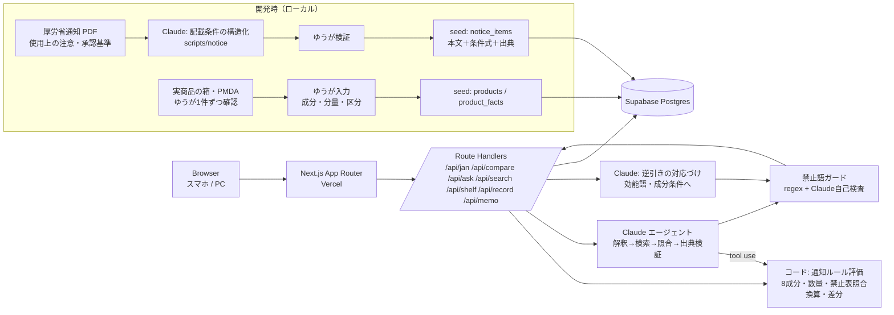

# System Architecture — ハコよみ（HakoYomi）

Version 2.0 / 2026-11-02 / 関連：`prd.md` v2.0 `rules.md`（L-20261102-32：データ3層・通知ルールエンジン・質問エージェント）

## 1. High-level Diagram

- 主経路は **JAN → 商品の事実 → 通知ルールの評価 → バッジ**。ここは Claude を使わず、決定的なコードで速く返す。
- Claude は質問エージェント（M3）、逆引きの対応づけ（M4）、販売記録の下書き（M7）、ガードの自己検査に使う。開発時は通知の記載条件の構造化に使う（人が検証）。
- 実行時に PMDA へ自動アクセスしない。商品固有の添付文書本文は持たない。
- 映像・画像は保存しない（Supabase Storage は使わない）。Supabase Auth は使わない（MVP）。

## 2. Technology Stack
| 層 | 技術 | 理由 |
|---|---|---|
| Frontend | Next.js（App Router）+ TypeScript + Tailwind CSS + shadcn/ui | スマホ/PC両対応、Vercel直結 |
| JAN読取 | @zxing/browser＋手入力・品名検索 | iOS Safari含め安定 |
| 商品データ | 実商品の事実 seed（ゆうが会期中に手入力・検証） | 事実のみ。本文・画像は持たない |
| 文面データ | 厚労省通知（使用上の注意 36薬効群＋指定濫用防止、承認基準の効能・効果） | 著作権法13条2号。出典URL・取得日つき |
| ルール評価 | `noticeRules`（条件式を JSON で持ち、成分事実に当てはめる純関数） | 速い・テスト可能・揺れない |
| Runtime AI | Claude API（tool use によるエージェント、逆引きの対応づけ、記録下書き、自己検査） | モデルは `.env` の `CLAUDE_MODEL`／`CLAUDE_MODEL_GUARD` |
| Validation | zod | 推薦欄なしのスキーマ、エージェント出力の検証 |
| DB | Supabase Postgres（全文検索は pg の `tsvector`＋trigram。ベクトル検索は P2） | 通知本文の検索、商品・棚・メモ・記録 |
| Hosting | Vercel | 提出URL |

## 3. Folder Structure
```
src/
  app/
    page.tsx                 # 読む（既定タブ）
    compare/page.tsx         # 比べる
    search/page.tsx          # さがす（逆引き・成分検索）
    shelf/page.tsx           # 棚
    api/jan/route.ts         # JAN → 商品事実 → バッジ（コードのみ）
    api/compare/route.ts     # 2〜4品 → 換算・差分（コードのみ）
    api/ask/route.ts         # 質問エージェント（Claude tool use）→ 出典検証 → ガード
    api/search/route.ts      # 自由入力 → Claude 対応づけ → コードで絞り込み → ガード
    api/shelf/route.ts       # 棚の位置
    api/record/route.ts      # 指定濫用防止の確認記録・販売記録下書き（P1）
    api/memo/route.ts        # ベテランの説明メモ（P1）
  components/  JanScanner, ProductCard, BadgeRow, BadgeSheet, AskBox, AnswerQuote, CompareTable, SearchBox, ResultList, StoreMap, ShelfFront, AbuseCheck, MemoList, JudgeNotice
  lib/
    rules/ noticeRules.ts, badges.ts, abuse.ts, doping.ts
    agent/ tools.ts, run.ts, verifyCitations.ts
    claude/ client.ts, prompts/{ask,search,record,guard}.ts
    schema/ product.ts, notice.ts, answer.ts
    units.ts
    guard/ banwords.ts, uiCopy.ts
    supabase/ server.ts
  data/ abuse_ingredients.ts, doping_list.ts, mock_store.json, mock_sop.ts
scripts/
  notice/                    # 通知PDF → 項目・記載条件の構造化（開発時。出力をゆうが検証して seed）
tests/
supabase/migrations/
```

## 4. Data Flow
- **開発時（通知）**：厚労省の通知 PDF → テキスト抽出 → Claude が項目ごとに「本文」「記載条件（成分・分量の条件式）」「薬効群・項目番号」へ構造化 → zod 検証 → ゆうが検証 → `notice_items` に seed。
- **開発時（商品）**：ゆうが箱と PMDA の添付文書で、品名・JAN・区分・薬効群・成分・分量・内容量を入力 → `products` / `product_facts`。本文は入れない。
- **読む（M1）**：JAN → `products` → 薬効群の `notice_items` の条件式を成分に当てはめ（コード）→ バッジ＋根拠。8成分・数量・禁止表もコード。
- **比べる（M2）**：2〜4品の事実 → `units.ts` で基準をそろえる → 差分（コード）。
- **質問（M3）**：質問 → エージェント（tools：`get_product_facts` `get_applicable_notice_items` `search_notice_text` `check_abuse` `check_doping`）→ 回答は「出典ID＋抜き出し文字列」の配列 → `verifyCitations` で原文と完全一致しない文を捨てる → ガード → 表示。
- **さがす（M4）**：自由入力 → Claude が承認基準の効能・効果の語と成分条件（含む／含まない）に対応づけ（JSON）→ コードで商品を絞り込み → 五十音順 → 一致根拠を付けて表示。入力は保存しない。
- **棚（M5）**：選んだ商品 → `shelf_locations` → マップと正面図（Claude 不使用）。

## 5. Database Schema
```mermaid
erDiagram
  products ||--o{ product_facts : "成分・分量"
  products ||--o{ shelf_locations : "置き場"
  products ||--o{ memos : "説明メモ"
  notice_items }o--|| notice_groups : "薬効群"
  checklist_sessions ||--o{ checklist_checks : "確認"
  products { uuid id PK; text jan; text name; text maker; text risk_class; text notice_group_id "通知の薬効群"; text dosage_basis "1日量など"; int content_qty; text content_unit; text pmda_url; date doc_revised_on; text entered_by; date verified_on; }
  product_facts { uuid id PK; uuid product_id FK; text ingredient; text ingredient_class "抗ヒスタミン剤 等"; numeric amount; text unit; text basis; bool uncertain; }
  notice_groups { text id PK "kaze_1 等"; text name; text source_url; date fetched_on; }
  notice_items { uuid id PK; text group_id FK; text section "してはいけないこと|相談すること|その他"; text item_no; text body "通知の本文"; jsonb condition "記載条件の式"; text condition_text "条件の原文"; }
  shelf_locations { uuid id PK; uuid product_id FK; text store_id "mock-store-1"; text area; text shelf; int tier; int column; }
  memos { uuid id PK; uuid product_id FK "null可"; text ingredient "null可"; text group_id "null可"; text body; text author_alias; timestamptz created_at; }
  checklist_sessions { uuid id PK; text staff_alias; uuid product_id; int quantity; timestamptz created_at; }
  checklist_checks { uuid id PK; uuid session_id FK; text item_code "ア〜キ"; timestamptz checked_at; }
```
- お客様の氏名・症状・健康情報のカラムは作らない。逆引き・質問の入力は保存しない。
- 商品固有の添付文書本文のカラムは作らない（`notice_items.body` は厚労省通知の本文のみ）。
- 8成分・数量基準・禁止表成分は `src/data` の静的定数（出典URL・日付・年版つき）。

## 6. Key Decisions
| 決定 | 理由 |
|---|---|
| データ3層（商品の事実／公的通知／照合リスト） | 失格条件「権利のないデータ」と PMDA 規約を避けつつ、実商品で動かす |
| 通知の記載条件をルール化してコードで評価 | 速い・正確・テスト可能。「基本的なRAG」との違いの中核 |
| 質問はエージェント＋抜き出し＋出典検証 | 言い換えによるずれを防ぎ、出典のない回答を出さない |
| 逆引きは Claude が対応づけ、絞り込みはコード | 自由入力の柔らかさと、結果の再現性・順位なしを両立 |
| バッジと差分は Claude を通さない | 速度と揺れ防止 |
| 認証なし | ソロ・期間短。担当者は仮名 |

## 7. Security / Safety
- 禁止語ガード必須（Claude 出力すべて）。UI 文言はホワイトリスト。
- 客向けモード・販売可否ボタン・順位付けなし。
- APIキーはサーバーのみ。RLS 有効、書き込みは service role。
- 入力文（質問・逆引き）はログに残さない。差し止めログは出力側のみ。
- 簡易レート制限（T801）。

## 8. Scalability & Future
実店舗の棚 CSV 取込、手順書アップロード、ベクトル検索、箱OCR、多店舗＋認証、店内での実添付文書利用（PMDA 規約の「所属薬局等での使用」の範囲で）。

## 9. External Services
Anthropic Claude API／Supabase／Vercel／GitHub／PMDA（リンクアウト先のみ）／JADA・Global DRO（リンク先のみ）。

## 10. Environment Setup
```
ANTHROPIC_API_KEY=
CLAUDE_MODEL=
CLAUDE_MODEL_GUARD=
SUPABASE_URL=
SUPABASE_SERVICE_ROLE_KEY=
```
※ キーは NEXT_PUBLIC_ にしない（サーバ側のみ）。
`@anthropic-ai/sdk` `@supabase/supabase-js` zod `@zxing/browser` → migrations → Vercel。

## 11. Conclusion
速さが要るところ（バッジ・差分・棚）は決定的なコード、柔らかさが要るところ（質問・逆引き）は Claude のエージェント。どちらも公的な出典にひもづけ、出典のない文は出さない。推薦はせず、判断と説明は登録販売者が行う。
